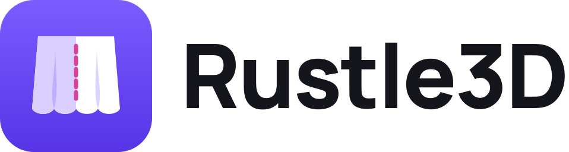

<p align="center">
  <picture>
    <source media="(prefers-color-scheme: dark)" srcset="assets/brand/logo-dark.svg">
    
  </picture>
</p>

<p align="center">
  <strong>3D garment design and cloth simulation, written in Rust.</strong><br>
  Draft sewing patterns in 2D, sew them, and drape them on an avatar with real-time cloth physics.
</p>

<p align="center">
  <a href="LICENSE"></a>
  
  
</p>

---

Rustle3D covers the core workflow of professional 3D fashion tools with a
simpler, more approachable interface. Everything the app does is also
available to scripts and AI agents, through a command-line tool and an
MCP server.

- [Features](#features)
- [Getting started](#getting-started): install the tools, get the code, run the app
- [Everyday commands](#everyday-commands)
- [Troubleshooting](#troubleshooting)
- [Project layout and documentation](#project-layout-and-documentation)
- [License](#license)

## Features

| Area | What you can do |
|---|---|
| **Patterns (2D)** | Start from templates drafted to the body's measurements (T-shirt, shirt, dress, skirts, trousers, tote bag) or draw pieces with polygon, curve and cut tools. Constraints, dimensions, formulas (`waist / 4 + 10 mm`), darts, pleats, holes, symmetric half pieces, notches and internal lines. |
| **Sewing** | Sew edges together, see direction and length mismatches, gather, add ease, match both sides in one click. Buttons and zippers close the garment. |
| **Drape (3D)** | Real-time XPBD cloth simulation on the GPU, with collisions, self-collision, pins and pulling the cloth with the mouse. Several garments in layers. Fabric presets (cotton, denim, jersey, silk, wool) and prints that follow the grainline. |
| **Avatars** | A parametric body set by its measurements, imported scans and characters (OBJ, glTF), walking motions and captured motions (BVH). |
| **Sizes and fit** | Grading over a size range, each size draped on a matching body; fit maps and a virtual tape measure. |
| **Production** | Markers with yardage and cost, a tech pack PDF, a projector mode for cutting on the table. |
| **Images** | Path-traced studio photos of the draped garment. |
| **Exchange** | Open formats only: patterns in SVG, PDF (1:1, tiled), DXF-AAMA; DXF, SVG and PDF import; the draped garment in glTF/GLB and OBJ, and game-ready exports (LODs, normal maps, skinning). |
| **Automation** | A headless CLI (`r3d`) and an MCP server, headless or attached live to the open app. |

The app is in English and French. Full user documentation:
[`docs/user-guide.md`](docs/user-guide.md).

## Getting started

Rustle3D is built from source for now. The steps below assume you have
never set up a Rust or Flutter project: follow the section for your
system, from top to bottom. Plan about an hour for the installs, and
10–15 minutes for the very first build (later ones take seconds).

You need, on every system:

| Tool | Why | Version |
|---|---|---|
| [Git](https://git-scm.com) | to download the code | any recent |
| [Rust](https://rustup.rs) (through `rustup`) | the core: geometry, simulation, rendering | stable (picked up automatically) |
| [Flutter](https://docs.flutter.dev/get-started/install) | the desktop interface | 3.47 or newer |
| A C/C++ toolchain | to build the desktop app around Flutter | see your system below |
| GNU make (optional) | short commands like `make run` | any |

The 3D view needs a graphics card with Direct3D 12 (Windows), Metal
(macOS) or Vulkan (Linux); any card from the last ten years should do.

### Windows 10 / 11

1. **Git**: install [Git for Windows](https://git-scm.com/download/win)
   (default options are fine). It also gives you *Git Bash*, used by a few
   scripts.
2. **Visual Studio**: install
   [Visual Studio 2022 Community](https://visualstudio.microsoft.com/downloads/)
   and, in the installer, tick the **Desktop development with C++**
   workload.
3. **Rust**: download and run
   [`rustup-init.exe`](https://rustup.rs), and accept the defaults (the
   MSVC toolchain).
4. **Flutter**: open *PowerShell* and run

   ```powershell
   git clone --depth 1 -b stable https://github.com/flutter/flutter.git C:\dev\flutter
   ```

   then add `C:\dev\flutter\bin` to your `PATH`: Start menu → *Edit the
   environment variables for your account* → *Path* → *Edit* → *New* →
   `C:\dev\flutter\bin` → OK.
5. **make** (optional): `winget install ezwinports.make`.
6. **Close and reopen PowerShell** so it sees the new tools, then check:

   ```powershell
   flutter doctor
   ```

   Only the **Windows** and **Visual Studio** lines need a ✓ (Android,
   Chrome and Android Studio are not needed).

Keep the code on a Windows drive (for example `C:\dev\rustle3d`), not
inside WSL.

### macOS 12 or newer

1. **Xcode**: install it from the App Store, open it once, then in
   *Terminal*:

   ```sh
   sudo xcode-select --switch /Applications/Xcode.app
   sudo xcodebuild -runFirstLaunch
   ```

   This also installs Git and make.
2. **Rust**:

   ```sh
   curl --proto '=https' --tlsv1.2 -sSf https://sh.rustup.rs | sh
   ```

   Accept the defaults, then open a new Terminal window.
3. **Flutter**:

   ```sh
   git clone --depth 1 -b stable https://github.com/flutter/flutter.git ~/development/flutter
   echo 'export PATH="$HOME/development/flutter/bin:$PATH"' >> ~/.zshrc
   source ~/.zshrc
   flutter doctor
   ```

   Only the **macOS** and **Xcode** lines need a ✓; install CocoaPods if
   `flutter doctor` asks for it.

### Linux (Ubuntu, Debian and derivatives)

1. **System packages** (compiler, make, GTK, Vulkan):

   ```sh
   sudo apt install git curl unzip xz-utils zip build-essential clang cmake \
     ninja-build pkg-config libgtk-3-dev mesa-vulkan-drivers libvulkan1
   ```

2. **Rust**:

   ```sh
   curl --proto '=https' --tlsv1.2 -sSf https://sh.rustup.rs | sh
   ```

   Accept the defaults, then open a new terminal.
3. **Flutter**:

   ```sh
   git clone --depth 1 -b stable https://github.com/flutter/flutter.git ~/development/flutter
   echo 'export PATH="$HOME/development/flutter/bin:$PATH"' >> ~/.bashrc
   source ~/.bashrc
   flutter doctor
   ```

   Only the **Linux toolchain** line needs a ✓.

Under WSL2, clone the code inside the Linux file system (for example
`~/dev`), not under `/mnt/c`: builds there are much slower. The app runs
through WSLg with software or Mesa graphics, so expect lower frame rates
than a native install.

### Get the code and run the app

The same on every system:

```sh
git clone https://github.com/jbm-home/rustle3d.git
cd rustle3d
make run
```

Without make, `cargo xtask run` does exactly the same. The first run
downloads dependencies and builds everything, then the app window opens.
In the terminal, `r` reloads the interface after a change to its Dart
code; `q`, Ctrl+C or closing the window quits.

`make run` starts a **debug** build: quick to rebuild, with hot reload,
but the 3D view is slower. To try the app at its real speed, use
`make run-release`.

## Everyday commands

Type `make` alone to list them; this list comes from the `Makefile`.

| make | without make | What it does |
|---|---|---|
| `make run` | `cargo xtask run` | the app, debug build (hot reload) |
| `make run-release` | `cargo xtask run --release` | the app, release build (real speed) |
| `make build` | `cargo xtask build` | builds the `r3d` CLI and the app, debug |
| `make build-release` | `cargo xtask build --release` | the same, release |
| `make test` | `cargo test --workspace` | the Rust tests |
| `make check` | `./scripts/check.sh` | everything CI checks; run it before every commit |
| `make release` | `./scripts/release.sh` | a packaged, unsigned release in `dist/`: a universal `.dmg` on macOS, an installer on Windows (needs Inno Setup 6), a `.tar.gz` on Linux |
| `make docs` | `cargo xtask gen-docs` | regenerates `docs/commands.md` |
| `make version` | `cargo xtask version` | sets the version to today's date (see below) |

Flutter options go in `ARGS` (or after `--` with `cargo xtask`), for
example to open the app on a fresh T-shirt project:

```sh
make run ARGS=--dart-define=R3D_DEMO=t_shirt
cargo xtask run -- --dart-define=R3D_DEMO=t_shirt
```

The command-line tool works without the app:

```sh
cargo run -p r3d-cli -- --help                     # all commands
cargo run -p r3d-cli -- new Skirt.r3d              # a new project
cargo run -p r3d-cli -- mcp --project Skirt.r3d    # serve it to an AI agent
```

Versions are release dates, `YY.M.D`: `26.11.19` is the release of
19 November 2026 (`26.1.5` for 5 January: no leading zeros). `make version`
sets today's date in `Cargo.toml` and `app/pubspec.yaml`; `make version
V=26.11.20` sets another one. The app shows it on its start screen.

Contributors also need `cargo install flutter_rust_bridge_codegen --version 2.13.0`
to regenerate the Dart bindings after changing `crates/r3d-ffi/src/api`;
see [`CONTRIBUTING.md`](CONTRIBUTING.md).

## Troubleshooting

| Symptom | What to do |
|---|---|
| `flutter`, `cargo` or `make` is "not recognized" / "command not found" | Open a new terminal after installing; check that the tool's folder is in `PATH`. |
| `flutter doctor` shows ✗ for Android or Chrome | Ignore it: only your desktop line matters. |
| Windows: `LNK1104: cannot open file … build_script_build.exe` | An antivirus is scanning the build. Set the user environment variable `CARGO_PROFILE_DEV_DEBUG` to `line-tables-only`, or exclude the `target` folder from scanning. |
| Windows: `make check` runs in WSL | Fixed in the `Makefile`, which uses Git Bash; make sure Git for Windows is installed. |
| The 3D view is slow | Use `make run-release`; debug builds are much slower. |
| Linux: no 3D view, Vulkan errors | Install your GPU's Vulkan driver (`mesa-vulkan-drivers` for AMD and Intel, the proprietary driver for NVIDIA). |

## Project layout and documentation

The core is a Rust workspace (`crates/`); the desktop app is Flutter
(`app/`) over it, through `flutter_rust_bridge`.

| Path | Contents |
|---|---|
| `crates/r3d-geom` | 2D geometry: Bézier curves, offsets, polygon operations, triangulation |
| `crates/r3d-core` | Document model, typed IDs, versioned JSON with migrations |
| `crates/r3d-commands` | Every operation as a typed command, with validation and undo |
| `crates/r3d-sim`, `r3d-sim-gpu` | XPBD cloth solver, on the CPU and on the GPU |
| `crates/r3d-render` | 2D board, 3D view and path-traced photos (wgpu) |
| `crates/r3d-io` | OBJ, glTF, SVG, PDF and DXF import and export |
| `crates/r3d-cli`, `r3d-mcp` | The `r3d` command-line tool and the MCP server |
| `crates/r3d-ffi`, `app/` | The bridge and the Flutter desktop app |

- [`docs/user-guide.md`](docs/user-guide.md): the user guide.
- [`docs/architecture.md`](docs/architecture.md): crates, data flow, threading.
- [`docs/physics.md`](docs/physics.md) and [`docs/rendering.md`](docs/rendering.md): cloth solver and photo renderer.
- [`docs/commands.md`](docs/commands.md): every command, for scripts and agents.
- [`docs/specs/`](docs/specs/): one spec per feature.
- [`ROADMAP.md`](ROADMAP.md): milestones, done and coming.
- [`CONTRIBUTING.md`](CONTRIBUTING.md): how to contribute, including the
  **clean-room policy**.

## License

GNU General Public License v3.0 or later (GPL-3.0-or-later), see
[`LICENSE`](LICENSE) and [`THIRD_PARTY_NOTICES.md`](THIRD_PARTY_NOTICES.md).
Rustle3D is free to use for any purpose, including commercial work; the
garments, patterns and images you make with it are yours, under any terms
you choose. If you distribute a modified version of Rustle3D, it must stay
under the GPL with its source code available. Contributions are welcome
under the [Contributor License Agreement](CLA.md), see
[`CONTRIBUTING.md`](CONTRIBUTING.md).
